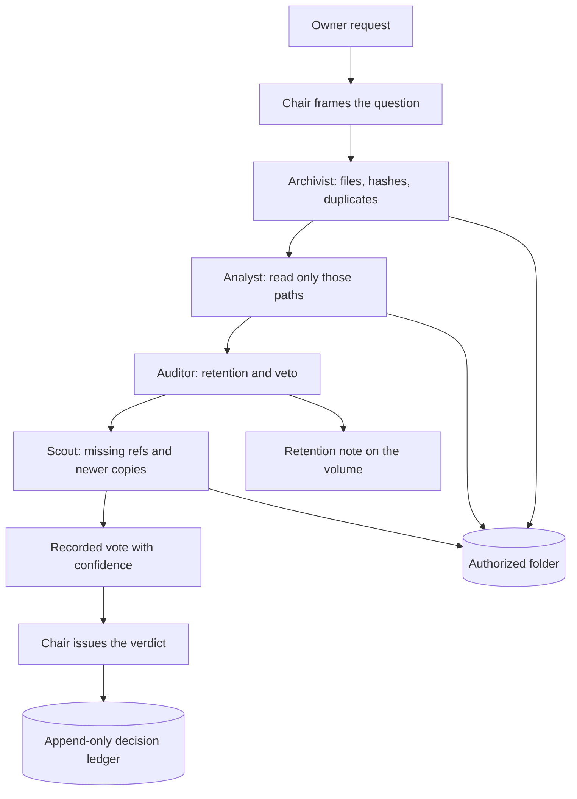

# The NAS Boardroom

Your NAS stops being a filing cabinet and becomes a boardroom.

One assistant will dedupe a folder, answer from a contract, or delete a path, and a week later nobody can see why. The NAS Boardroom puts five on-device experts in the room instead. They speak in turn, vote with a confidence score, and the Chair writes a verdict into an append-only ledger. The NAS can answer "why did you do that?" with the receipt.

This is an independent [UGREEN Hackathon 2026](https://ugreenhackathon.devpost.com/) Round 1 entry for the Open Innovation track. It is not an official UGREEN product. Round 1 runs on a laptop. No NAS, and no cloud call, is required.

## The five seats

| Seat | Job |
| --- | --- |
| **The Chair** | Frames the question, runs the vote, issues the verdict. The Chair does not vote. |
| **The Archivist** | Knows the files: hashes, duplicate sets, which copy to keep. |
| **The Analyst** | Reads what the question actually needs: a signature, a JPEG with no text, nothing else. |
| **The Auditor** | The conscience. Retention, confirmation, and a veto on risky deletes. |
| **The Scout** | The edges: a newer byte-identical copy, a same name with different bytes, a path that is cited and missing. |

An Auditor block at **0.70** or higher vetoes a destructive request, even if the other seats approve. Saying "I confirm" does not override a retention block on signed contracts. Duplicate cleanup is a **proposal**. This build moves nothing and deletes nothing.



## Run it

Python 3.10 or newer. The board itself uses the standard library.

```bash
git clone https://github.com/AaronGrace978/the-nas-boardroom.git
cd the-nas-boardroom
python3 -m venv .venv
. .venv/bin/activate
python -m pip install -e ".[dev]"
./demo.sh
pytest
```

On Windows, after the venv is activated:

```powershell
python -m pip install -e ".[dev]"
.\demo.ps1
pytest
```

`./demo.sh` seeds a fictional volume at `demo-nas/`, pins the board's calendar to **2026-10-26** so "last quarter" stays Q3, and convenes three sessions:

1. **Duplicate-cleanup proposal.** `find duplicate photos and propose cleanup`
2. **A document question.** `what did I sign last quarter?`
3. **A risky delete the Auditor blocks.** `delete all files in Documents/Contracts, including the signed originals`

Each session prints the minutes: framing, exhibits, four speeches, the vote, and the verdict. The receipts land in `ledger/DECISIONS.md`. The demo stages a fresh ledger first. `boardroom.ledger.append` itself only appends.

One question, after the volume exists:

```bash
python -m boardroom "find duplicate photos and propose cleanup"
```

If a local [Ollama](https://github.com/ollama/ollama) model is already listening on `127.0.0.1`, it may rephrase a speech. Any other host is ignored. Votes stay on the rules. With no model, the heuristic speeches are the session. Pass `--no-llm` to skip the probe.

Exit 0 means the board finished, including a block. Exit 2 means the folder could not be read. Exit 3 means the receipt was not written.

## What the three sessions show

The seeded volume is a small studio: a sunset still copied into Photos, Downloads, and a different older namesake in Archive; contracts signed in May, August, September, and October 2026; a retention note that keeps signed contracts for seven years; a vendor agreement that cites an exhibit which is not on the disk.

- The duplicate session keeps `Photos/2026/beach-sunset.jpg`, holds the two byte-identical copies for confirmation, and leaves `Archive/beach-sunset-v1.jpg` out because the hash differs. The contracts are not opened.
- The signature session, sitting on 2026-10-26, answers with the August 14 vendor agreement and the September 2 photo release. The May lease and the October workshop release are named only as exclusions. The missing exhibit is reported, not invented.
- The delete session is blocked. The four contracts are still on disk. The ledger says why.

## Entrypoints

The skill and the prototype share one contract:

| Entrypoint | What it does |
| --- | --- |
| `boardroom.convene` | Run the deliberation. Change no file. |
| `boardroom.verdict` | The Chair's outcome from the recorded votes. |
| `boardroom.ledger` | Append the receipt. On the laptop this is `boardroom.ledger.append`. |

```python
import boardroom

session = boardroom.convene(
    "what did I sign last quarter?",
    nas_root="demo-nas",
)
boardroom.verdict(session)
boardroom.ledger.append(session, "ledger/DECISIONS.md")
```

## The skill package

UGOS skills are a folder with `SKILL.md` at the root. That folder is [`skills/nas-boardroom/`](skills/nas-boardroom/SKILL.md). Zip it from inside the folder so the archive root is the skill, not the prototype:

```bash
cd skills/nas-boardroom
zip -r ../../dist/nas-boardroom-skill.zip SKILL.md references
```

The prototype, tests, and demo scripts stay in the git repo. They are how Round 1 runs without a NAS. They are not part of the skill ZIP. Scripts are outside the Uliya package rules.

On device, the same workflow is Markdown orchestration: the File management assistant inventories and hashes, the Document and Photo assistants read the exhibits, the Auditor reads `Policies/retention.md`, the Scout checks cited paths, and the Knowledge assistant saves the ledger by reading it back and writing the previous text plus one entry. If that read fails, the skill stops rather than hiding history. The laptop ledger is a true append, which is the behavior the format describes.

## Layout

```
skills/nas-boardroom/SKILL.md    skill package root
boardroom/                       laptop prototype
demo.sh / demo.ps1               three showcase sessions
ledger/DECISIONS.md              append-only receipts
tests/                           deliberation, voting, ledger
PROPOSAL-DRAFT.md                Round 1 answers, under 500 words
```

## Status

Built: the five-seat loop, the confidence tally, the 0.70 veto, the transcript, the append-only ledger, and the three-scenario demo.

Not built: installing the skill inside Uliya, live expert calls, and performing a confirmed move.

Still to test on a NAS, if this project is a finalist: expert handoff, permission prompts, and writing the ledger on the volume.

## License

MIT. Third-party notes for the prototype and the skill package are in [`skills/nas-boardroom/references/disclosure.md`](skills/nas-boardroom/references/disclosure.md).
